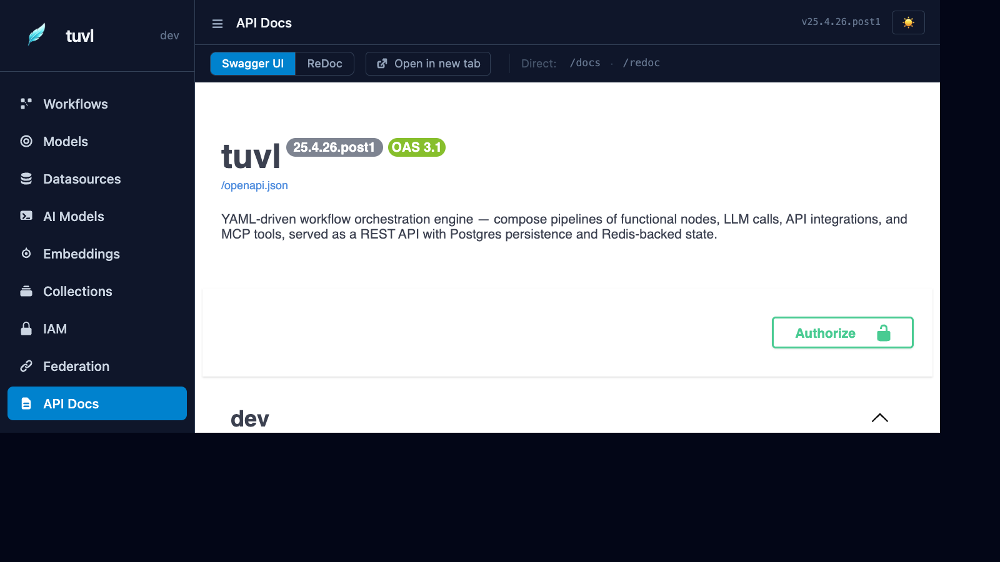

# API Docs

The **API Docs** section embeds a live Swagger UI for your project's REST endpoints. Every auto-generated CRUD route, workflow execution endpoint, and auth route is visible and callable directly from the browser.



---

## What you'll find here

The Swagger UI at `/insight/api-docs` proxies the OpenAPI schema from `/docs` and renders it in the portal's theme. It includes:

| Category | Routes |
|----------|--------|
| **Workflow triggers** | each workflow's own `trigger.http.path` (e.g. `POST /api/screen-candidate`), typed from its contract |
| **Runs** | `POST /api/workflows/{name}/runs`, `GET /api/runs`, `GET /api/runs/{id}`, `GET /api/runs/{id}/events` (SSE), `GET /api/runs/{id}/export`, `POST /api/runs/{id}/pause\|resume\|abort\|steer` |
| **Approvals** | `GET /api/approvals`, `POST /api/approvals/{id}`, `POST /api/runs/{id}/human/{agent_id}` |
| **Model CRUD** | `/models/{model}/…` — only for models that opt in with `spec.api.crud` |
| **Auth** | `/auth/token`, `/auth/me`, `/auth/refresh`, `/auth/logout`, `/auth/bootstrap`, `/auth/oauth/{provider}/…`, `/auth/admin/*` |
| **System** | `/health`, `/registry`, `/admin/*`, `/api/artifacts` |

MCP export (`/mcp`) isn't an OpenAPI route; see [API: REST, SSE, MCP](../internals/api.md#mcp-export).

---

## Trying endpoints

1. Click the **Authorize** button (🔒) at the top of the Swagger UI.
2. Enter your access token in the `Bearer` field.
3. Expand any endpoint, click **Try it out**, fill in the parameters, and click **Execute**.

In dev mode, you can use the dev API key directly as a bearer token.

---

## Running a workflow via the API

Call the workflow's own route:

```http
POST /api/screen-candidate
Authorization: Bearer <token>
Content-Type: application/json

{ "full_name": "Asha Menon", "email": "asha@example.com", "years_experience": 6,
  "skills": ["Python", "PyTorch", "LLMs", "RAG"] }
```

The response is the end the run reached — its `status` and `body`:

```http
HTTP/1.1 201 Created
X-Tuvl-Run-Id: 5b0d…

{ "id": "c9e2…", "status": "shortlisted", "fit_score": 88 }
```

If the run waits for a person (a `human` agent) or outlives the request, the response is `202` with a
run descriptor (`status_url`, `events_url`, and the pending `approval`). Any workflow can also be
started by name with `POST /api/workflows/{name}/runs`.

---

## Following a run

Every step is journaled. Follow a run over Server-Sent Events — the journal replays, then goes live:

```http
GET /api/runs/5b0d…/events
Authorization: Bearer <token>
Accept: text/event-stream
```

```
id: 3
event: decision
data: {"seq":3,"type":"decision","agent_id":"gate","engine":"decide","payload":{"decision":"assess","source":"rule#1"}}
```

Reconnect with `Last-Event-ID` (or `?from_seq=`) to resume without gaps. Reading a run needs the
`runs:read` scope (your own runs) or `iam:admin`. Event types are listed in
[Runtime](../internals/runtime.md#journal-events).

---

## Raw OpenAPI schema

The raw JSON schema is available at `/openapi.json`. Import it into Postman, Insomnia, or any API tool that accepts OpenAPI 3.x.
