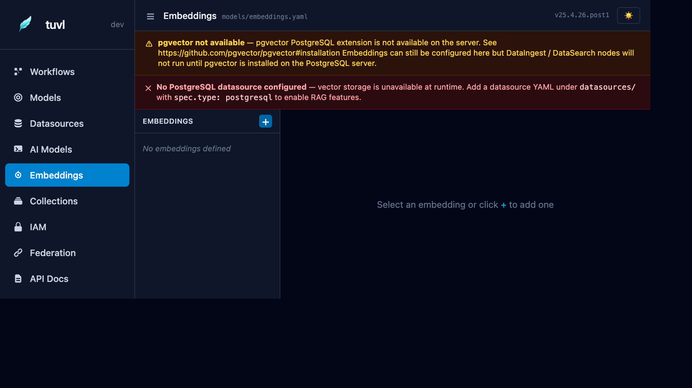
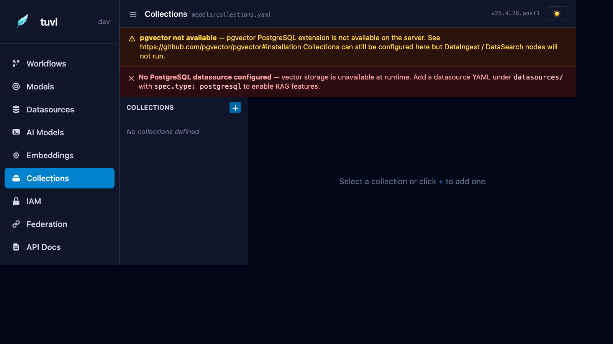

# Embeddings & Collections

The **Embeddings** and **Collections** sections configure tuvl's vector search stack. Together they power Retrieval-Augmented Generation (RAG) inside your workflows.

| Section | Screenshot |
|---------|-----------|
| Embeddings |  |
| Collections |  |

---

## Concepts

**Embedding model** — An `EmbeddingModel` config defines which model converts text into a vector (e.g. `nomic-embed-text` via Ollama, or OpenAI's `text-embedding-3-small`).

**Collection** — A `VectorCollection` config defines a named pgvector table: which embedding model to use, the vector dimension, and the distance metric. Think of a collection as a searchable knowledge base.

---

## Requirements

Both features require:

1. **pgvector extension** — installed in your PostgreSQL database:
   ```sql
   CREATE EXTENSION IF NOT EXISTS vector;
   ```
2. A connected and enabled **Datasource** (see [Datasources](datasources.md)).

---

## Embeddings

### EmbeddingModel YAML

```yaml
kind: EmbeddingModel
version: v1
enabled: true
metadata:
  name: default_embeddings
  description: Ollama nomic-embed-text
spec:
  model: ollama/nomic-embed-text
  api_base: http://localhost:11434
  dimensions: 768
```

| Field | Description |
|-------|-------------|
| `model` | `provider/model` of an OpenAI-compatible embeddings endpoint (OpenAI, Gemini, Ollama, Cohere, Voyage, a gateway) |
| `api_base` | Optional — a gateway or proxy; Ollama defaults to `OLLAMA_BASE_URL` |
| `api_key` | Optional `${ENV_VAR}` reference; blank uses the provider's key variable |
| `dimensions` | Vector size — must match the model's output dimension |

### Common embedding models

| Provider | Model string | Dimensions |
|----------|-------------|------------|
| Ollama | `ollama/nomic-embed-text` | 768 |
| Ollama | `ollama/mxbai-embed-large` | 1024 |
| OpenAI | `openai/text-embedding-3-small` | 1536 |
| OpenAI | `openai/text-embedding-3-large` | 3072 |
| Cohere | `cohere/embed-english-v3.0` | 1024 |
| Voyage | `voyage/voyage-3` | 1024 |

---

## Collections

### VectorCollection YAML

```yaml
kind: VectorCollection
version: v1
enabled: true
metadata:
  name: hr_knowledge_base
  description: HR policy documents and FAQs
spec:
  embedding_model: default_embeddings   # references EmbeddingModel metadata.name
  dimensions: 768
  distance_metric: cosine               # cosine | l2 | inner_product
  table: hr_documents                   # PostgreSQL table name
```

### Distance metrics

| Metric | Use when |
|--------|----------|
| `cosine` | Most text similarity tasks (default) |
| `l2` | Euclidean distance — good for dense numerical embeddings |
| `inner_product` | Normalised embeddings where dot product == cosine |

---

## Using RAG in a workflow

Search and ingest are built-in `code` agents with typed contracts:

```yaml
- id: retrieve_policy
  description: Find the relevant policy passages
  engine: code
  inputs:  { employee_question: str }
  outputs: { hits: "list[json]" }          # [{content, metadata, score}]
  code:
    run: tuvl.data_search
    with: { collection: hr_knowledge_base, query: "{{ employee_question }}", top_k: 5 }
  routes: { default: answer, error: END.failed }

- id: ingest_policy
  description: Add a policy document to the knowledge base
  engine: code
  inputs:  { title: str, content: str }
  outputs: { doc_id: uuid }
  code:
    run: tuvl.data_ingest
    with: { collection: hr_knowledge_base, document: "{{ content }}", metadata: { title: "{{ title }}" } }
  routes: { default: END, error: END.failed }
```

In the workflow editor, a search or ingest step has a **Collection** dropdown listing the collections configured here, with the embedding each
one uses, and the **+ Add step** palette has **Retrieve and answer**: a search routed into an `llm` step that answers only from the passages and
returns its `sources`.

A `loop` agent can also search a collection as a tool, with no wrapper agent:

```yaml
loop:
  model: default
  steering: Answer from the knowledge base only.
  tools:
    - collection: hr_knowledge_base      # offered to the model as search_hr_knowledge_base(query)
      top_k: 3
```

Pass `hits` to an `llm` agent as an input to ground its answer. See the knowledge-base-qa
[example](../examples/example-projects.md).
