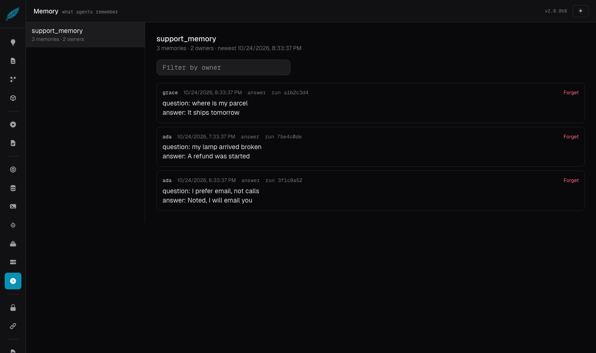

# Memory

The **Memory** page shows what agents remember across runs and lets you forget it. A memory is a row that an
`llm.memory` or `loop.memory` block, or the `tuvl.memory_remember` built-in, stored in a collection; this page reads and
deletes those rows. Knowledge-base collections never appear here: only rows that belong to an owner count as memory.

---

## What you see

| Where | What it shows |
|-------|---------------|
| Left list | Each collection that holds memories, with the number of memories and owners |
| Header | The collection, how many memories and owners it has, and when the newest was written |
| **Filter by owner** | Narrows the list to one owner (the signed-in user, the tenant, or the key the workflow named) |
| Each memory | The owner, when it was stored, the agent and run that wrote it, and the text itself, newest first |

The agent and run on each memory are how you answer "where did it learn that?": open the run on the Runs page and the
journal shows the `memory_recalled` and `memory_written` events of the steps involved.

## Forgetting

- **Forget** on a memory deletes that one row.
- **Forget everything of this owner** deletes all of one owner's memories in the collection. It asks for a second click and
  names how many memories it will remove.
- The same erasure is available from the terminal: `tuvl prune memory <collection> --key <owner>`, or
  `--older-than 30d` for age. Both print how many rows were removed and touch nothing else.
- To forget automatically, set `retention: 90d` in the agent's memory block.

## In the agent panel

An `llm` or `loop` agent has a **Remember across runs** section on its Engine tab (named **Prompt** or **Loop**).
Tick it to add the block, then choose:

| Field | Meaning |
|-------|---------|
| Memory collection | A configured collection (see [Embeddings & Collections](embeddings-collections.md)) |
| Whose memory | The signed-in user (default), the tenant, or a template over the agent's inputs. The model never chooses. A template is refused on a public trigger |
| Latest memories / Related older | How many recent memories, and how many older ones related to the prompt, go into the prompt |
| Prompt tokens | The most recalled text put in the prompt; it counts towards the workflow's worst-case token cost |
| Store after a run | The inputs and outputs that are remembered (empty: every output). A secure field is refused |
| Forget after | How long a memory is kept, for example `90d` |

Unticking the box removes the block. The **YAML** tab shows exactly what was written.

See [Remembering across runs](../internals/engines.md#remembering-across-runs-llmmemory-loopmemory) for the full rules.
