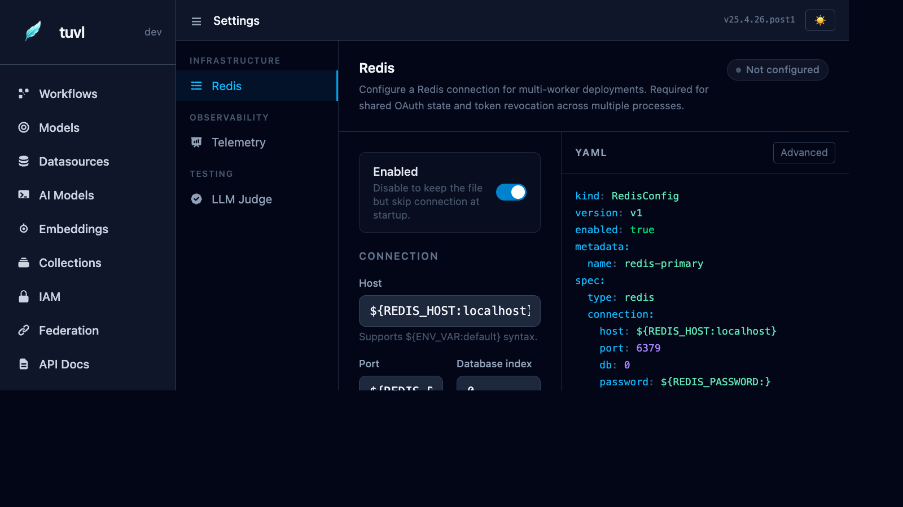

# Settings

The Settings section configures project-level infrastructure and observability integrations. Changes are written to YAML config files and take effect after a reload.



---

## Navigation

The left panel groups settings into these categories (Project opens first):

| Category | Item | Purpose |
|----------|------|---------|
| General | Project | The project's identity and its listing in the public catalogue |
| Infrastructure | Redis | Shared state for multi-worker deployments |
| Observability | Telemetry | OpenTelemetry trace and metric export |
| Security | API Access | Control which HTTP API surfaces are mounted |

---

## Project

The **Project** page edits `.tuvl/project.yaml`: the identity `tuvl init` gave the project.

| Field | Notes |
|-------|-------|
| Project id | Read-only. `prj_<uuidv7>-<check>`, created once; a hand-edited id fails its check and Insight refuses to register it |
| Name, Author, Developer email | Email stays private unless you choose to publish it |
| Type | `PoC`, `Dev` or `Production` |
| Version | The application's own semver, not the engine's |
| Description | Markdown, up to 2000 characters, with an **Edit / Preview** toggle |
| License, Repository | Optional; the repository must be an `http(s)` URL |

The **Catalogue** card below the form shows whether the project is listed on [hub.tuvl.io](https://hub.tuvl.io):
not listed, up to date, changed since the last registration, or id changed. **Register** (or **Update
listing** once listed) opens a dialog with the exact payload that will be sent and a *Show my developer
email publicly* checkbox. **Send** registers directly when this machine already has a hub login;
otherwise it shows a GitHub device code, waits for you to approve it and then registers. The hub token
stays on the dev server, never in the browser.

The same actions are available from the CLI: see [Project and Catalogue](../internals/project.md).

---

## Redis

Redis is required when running tuvl with more than one uvicorn worker. Without Redis, OAuth2 CSRF state tokens and token revocation lists (and session ends) are stored only in each worker's memory — causing random failures when a request lands on a different worker than the one that started the session.

### Redis YAML format

```yaml
kind: RedisConfig
version: v1
enabled: true
metadata:
  name: redis-primary
spec:
  type: redis
  connection:
    host: "${REDIS_HOST:localhost}"
    port: "${REDIS_PORT:6379}"
    db: 0
    password: "${REDIS_PASSWORD:}"
```

### Redis fields

| Field | Description | Default |
|-------|-------------|---------|
| `host` | Redis server hostname | `localhost` |
| `port` | Redis port | `6379` |
| `db` | Database index (0–15) | `0` |
| `password` | AUTH password (leave blank for no auth) | _(empty)_ |

!!! note "env var syntax"
    All fields support `${ENV_VAR:default}` substitution. Set `REDIS_HOST`, `REDIS_PORT`, and `REDIS_PASSWORD` in your `.env` file or environment.

---

## Telemetry

tuvl ships with built-in [OpenTelemetry](https://opentelemetry.io/) support. Traces and metrics can be exported to any OTLP-compatible backend (Jaeger, Tempo, Honeycomb, Datadog, …).

### Telemetry YAML format

```yaml
kind: TelemetryConfig
version: v1
spec:
  enabled: true
  otlp_endpoint: http://localhost:4318
  otlp_protocol: http/protobuf     # http/protobuf (default) | grpc
  service_name: tuvl
```

### Protocol options

| `otlp_protocol` | Description |
|----------|-------------|
| `http/protobuf` | OTLP over HTTP (default), port 4318. Spans go to `<endpoint>/v1/traces`, metrics to `<endpoint>/v1/metrics` |
| `grpc` | OTLP over gRPC, port 4317. Needs `tuvl[otel-grpc]`; `tuvl ship` installs it when this is set |

Environment variables win over this file: `TUVL_OTLP_ENDPOINT`, `OTEL_EXPORTER_OTLP_ENDPOINT`,
`TUVL_OTLP_PROTOCOL`, `OTEL_EXPORTER_OTLP_PROTOCOL`. If you upgraded from a version that used gRPC and
your endpoint still ends in `:4317`, tuvl logs a warning at startup.

See [Observability](../internals/observability.md) for spans, logs and collector setup (Grafana Tempo, Honeycomb, Datadog).

---

## API Access

Control which HTTP API surfaces are mounted. This edits `.tuvl/system.yaml`
(`kind: SystemConfig`) — see [Configuration Overview](../configuration/overview.md#systemconfig-tuvlsystemyaml)
for the full knob reference.

### Expose model CRUD APIs

A toggle for `spec.api.expose_model_crud`. When off, only workflow APIs are
mounted — `/models/*` CRUD endpoints return 404. This applies in production too;
the `TUVL_EXPOSE_MODEL_CRUD` env var overrides whatever is saved here.

!!! warning "Restart required to apply changes"
    The API surface is mounted once at startup. Save your config here, then
    restart the engine with `tuvl run` (or `tuvl dev`) for changes to take effect.
